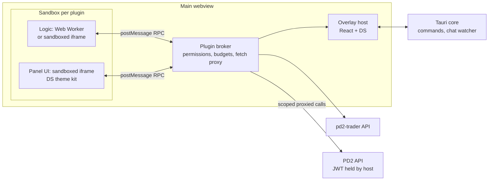
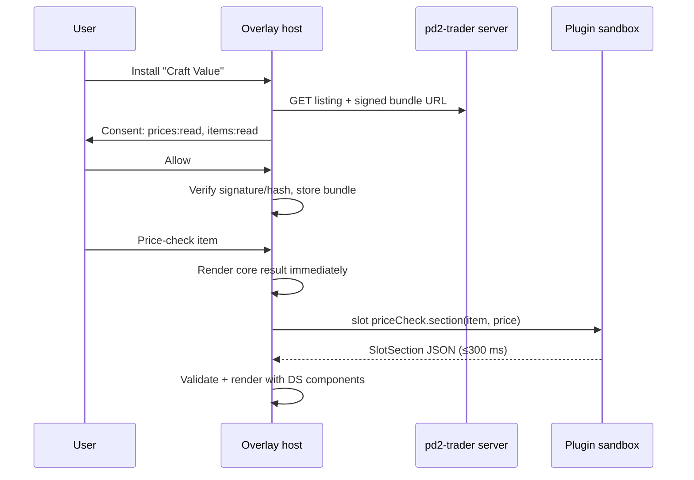

# PRD: Design System + Plugin Platform & Marketplace

|                |                                                                                                           |
| -------------- | --------------------------------------------------------------------------------------------------------- |
| **Status**     | Draft. Interview in progress; decisions marked _Proposed_ need confirmation (§13)                         |
| **Repos**      | pd2-trade (overlay, Tauri 2 / React 18 / Tailwind 4), pd2-price-crawler (NestJS/Mongo, website `client/`) |
| **Sequencing** | Design system first (Phase 1); the plugin platform depends on it                                          |

## 1. Summary

Two linked deliverables:

1. **PD2 Trader Design System (DS)**: tokens, a component library and enforced design rules. The overlay uses it to make every surface consistent, and plugins use it so third-party UI looks native.
2. **Plugin platform + marketplace**: a sandboxed, permissioned, versioned SDK. Plugins can add panels and hook into existing surfaces (price check, market browser, chat, stash/net worth, settings, hotkeys). A marketplace handles discovery, install, review and updates.

The aim is to make the overlay the PD2 hub. Community developers, many of them AI-assisted, build the niche features instead of the core team, and plugins consume the pd2-trader price/market API.

## 2. Current state (evidence)

| Area                | Today                                                                                                                                                                                                   | Source                                                 |
| ------------------- | ------------------------------------------------------------------------------------------------------------------------------------------------------------------------------------------------------- | ------------------------------------------------------ |
| Overlay window      | One transparent, always-on-top, non-focusable `Main` webview; every surface is a panel in one React tree                                                                                                | `ARCHITECTURE.md` §Overlay window & panels             |
| Panel registry      | `itemSearch`, `quickList`, `currency`, `chat`, `chatButton`, `settings`, `changeLog`, `signIn`, `delist`, `netWorthTicker`, `netWorthPanel`, `market`; opened via `useOverlay()`                        | `src/overlay/registry.tsx`                             |
| Privileged commands | `press_key` (Enigo keystrokes), `get_diablo_rect`, chat-log watcher, game file reads                                                                                                                    | `src-tauri/src/modules/commands.rs`, `chat_watcher.rs` |
| Auth                | PD2 JWT stored in app settings and sent as Bearer to `api.projectdiablo2.com`                                                                                                                           | `src/hooks/useOptions.tsx`, `ARCHITECTURE.md` §4       |
| Components          | ~30 shadcn (new-york, zinc, lucide) primitives in `src/components/ui`; ad-hoc patterns in `components/custom` (`window-chrome`, `popover-parts`, `hover-popover`) and `optionsv2/settings-ui.tsx`       | `components.json`, `src/components/`                   |
| Tokens              | shadcn semantic tokens plus overlay tokens: `--surface`/`--surface-elevated` (window opacity), `--glow`, `--scrim`, item quality `--q-*`, motion `--ease-*`/`--dur-*`, `--shadow-panel`/`--shadow-glow` | `src/globals.css`                                      |
| Themes              | 21 themes (11 dark, 10 light), each filling the full `THEME_TOKENS` list; enforced by test                                                                                                              | `src/lib/themes.ts`, `themes.test.ts`                  |
| Token debt          | Mixed `hsl()`/`oklch()`; raw-HSL "attack class" colors defined outside the semantic layer                                                                                                               | `src/globals.css` `@theme inline`                      |
| Website             | Plain JSX + hand-written CSS, one Radix tooltip, recharts; shares nothing with the overlay                                                                                                              | `client/package.json`, `client/src/components/ui`      |
| Extensibility       | None. No plugin loading, no extension points                                                                                                                                                            | n/a                                                    |

## 3. Goals / Non-goals

**Goals**

- One source of truth for visual language across the overlay and plugins. A plugin built on the DS follows all 21 themes and the window-opacity setting with no extra work.
- Grow the ecosystem and retention: more reasons to keep the overlay running.
- Offload niche feature requests to community plugins.
- Data network effect: plugins built on the pd2-trader price/market API.
- Safe by construction: plugin code can't read the PD2 JWT, send game input or reach undeclared hosts.
- Plugins feel native: they extend existing surfaces instead of living only in separate windows.

**Non-goals (v1)**

- Paid plugins, revenue share, licensing.
- Any game-input automation. `press_key` is never exposed (botting risk, PD2 bans).
- Raw-token access for plugins.
- Migrating the website to the DS (Phase 4, _Proposed_).
- Native/Rust plugins. Plugins are JS/TS only.

## 4. Users and stories

- **Player**: "I want a craft-value calculator under my price check, installed in one click, and it shouldn't be able to steal my account."
- **AI-assisted hobbyist dev**: "I prompted a plugin together in an evening; the template, rules file and local dev mode kept it looking like the rest of the app."
- **Experienced dev**: "Typed SDK, semver'd slots, a test harness, and stats showing how many people use my plugin."
- **Core team**: "New core features use the same DS components; reviewing a plugin means checking its permissions, not reading 3,000 lines of generated JS."

## 5. Part A: Design System

Priority: **P0** required for the milestone · **P1** should ship · **P2** later.

### A1. Tokens

| ID   | Feature                                                                                                                                                                                                           | Pri |
| ---- | ----------------------------------------------------------------------------------------------------------------------------------------------------------------------------------------------------------------- | --- |
| A1.1 | Single token source (TS/JSON) generating CSS vars, the Tailwind 4 `@theme` block, and typed TS exports. `THEME_TOKENS` becomes the generated list                                                                 | P0  |
| A1.2 | Normalize to `oklch` across all 21 themes; keep the "every theme defines every token" test                                                                                                                        | P0  |
| A1.3 | Tiers: **primitive** (palette) → **semantic** (`surface`, `fg`, `muted`, `accent`, `success`…) → **domain** (`q-unique`…`q-corrupted`, `glow`, price up/down). Components consume only semantic and domain tokens | P0  |
| A1.4 | Scales: spacing (4px base), type (overlay-dense sizes), radius, elevation (`shadow-panel`, `shadow-glow`), motion (`ease-out`, `ease-spring`, `dur-fast/med/slow`), z-layers for overlay panels                   | P0  |
| A1.5 | Move the attack-class colors into the domain tier, or delete them if unused                                                                                                                                       | P1  |
| A1.6 | Density mode (compact/comfortable) as a token set                                                                                                                                                                 | P2  |

### A2. Component library

Built on the existing shadcn/Radix primitives, owned and extended (_Proposed_).

| ID   | Feature                                                                                                                                                                                                               | Pri |
| ---- | --------------------------------------------------------------------------------------------------------------------------------------------------------------------------------------------------------------------- | --- |
| A2.1 | **Primitives**: audit and harden the existing ~30 `ui/` components (variants via `cva`, token-only styling, a11y, keyboard behavior in a non-focusable overlay)                                                       | P0  |
| A2.2 | **Overlay patterns** promoted to first-class components: `PanelChrome` (from `window-chrome`), `HoverPopover`, `PopoverParts`, `SettingsSection/Row` (from `settings-ui`), `EmptyState`, `ErrorChip`, `Skeleton` rows | P0  |
| A2.3 | **Domain components**: `ItemName` (quality color), `PriceTag` (HR/rune/gold units, trend), `RuneIcon`, `CurrencyAmount`, `StatLine`, `MarketRow`, `SparkChart`                                                        | P0  |
| A2.4 | **Slot components**: the exact components plugins render into core slots (`SlotSection`, `SlotBadge`, `SlotColumn`, `SlotAction`), see §6.4                                                                           | P0  |
| A2.5 | Every component works in all 21 themes and at every window opacity; visual regression snapshots per theme                                                                                                             | P1  |

### A3. Design rules and enforcement

| ID   | Feature                                                                                                                                                                        | Pri |
| ---- | ------------------------------------------------------------------------------------------------------------------------------------------------------------------------------ | --- |
| A3.1 | Written rules: layout/spacing, density, typography, color usage (semantic only), iconography (lucide), motion, copy tone, empty/loading/error states                           | P0  |
| A3.2 | Lint: ESLint + Tailwind rules banning raw colors, arbitrary values (`[#fff]`, `[13px]`) and direct `ui/` internals in features; runs in CI for core and in the plugin template | P0  |
| A3.3 | Catalog site (Storybook or Ladle) with every component × theme, plus slot previews                                                                                             | P1  |
| A3.4 | **AI-ready rules**: `DESIGN_RULES.md` + `llms.txt` + machine-readable component manifest shipped in the package and plugin template, so AI tools build to the system           | P0  |
| A3.5 | Design checklist used in plugin review (§7.3)                                                                                                                                  | P1  |

### A4. Packaging

- Published package `@pd2-trader/ui` (_Proposed_), containing tokens, React components, a Tailwind preset and the generated CSS. The overlay consumes it like any plugin does, and it is versioned in step with the SDK.
- Visual direction: formalize the current "modern neutral + D2 accents" look (_Proposed_). Present 2-3 SVG direction mockups (panel, price check, market row) before locking it.

### A5. Core migration

- Migrate every overlay surface to DS components and tokens, panel by panel. Lint stays warn-only until a panel is migrated, then errors.
- Exit: zero raw-color / arbitrary-value lint violations in `src/`.

## 6. Part B: Plugin platform

### 6.1 Decisions (from interview)

| Topic          | Decision                                                                                                    |
| -------------- | ----------------------------------------------------------------------------------------------------------- |
| Goals          | Ecosystem/retention, offload feature requests, data network effects. No revenue in v1                       |
| Plugin types   | Own panels, item hooks, chat hooks, themes/cosmetic. **No game input / automation**                         |
| Trust model    | Sandboxed + capability permissions with user consent                                                        |
| Account access | Proxied and scoped: the host makes account calls for the plugin after consent; the JWT is never exposed     |
| Developers     | AI-assisted hobbyists and experienced devs                                                                  |
| Hook points    | Price-check result, market browser, chat messages, stash/net worth, settings, hotkeys + command palette     |
| Rendering      | Hybrid: declarative host-rendered UI in core slots; sandboxed iframe + DS theme kit for plugin-owned panels |
| Contract       | Versioned typed API; manifest declares the SDK version it targets                                           |
| Performance    | Core renders first; plugin slots fill asynchronously with a hard timeout; repeat offenders auto-disabled    |
| Network        | Proxied `fetch` limited to domains declared in the manifest and shown at install                            |

### 6.2 Runtime architecture



- **Isolation** (M0 spike, macOS observed, Windows pending): each plugin's logic runs in a Worker spawned inside a hidden `<iframe sandbox="allow-scripts" srcdoc>` (never `allow-same-origin`, never served from a registered URI scheme: Tauri's plugin ACL treats `pd2plugin://` frames as "local" by URL scheme). The srcdoc starts with a strict meta CSP (`connect-src 'none'`). All I/O goes through a `MessageChannel` to the broker; the host authenticates by `event.source` (sandboxed origin is `"null"`).
- **No Tauri IPC in sandboxes**: on macOS the invoke key is injected into the main frame only, so sandboxed frames can't call commands. On Windows, WebView2 injects init scripts into all frames, so frames likely get the key ([INFERENCE], re-test checklist in spike). Prerequisites before any plugin ships: upgrade Tauri 2.9.5 → ≥ 2.11.6 (GHSA-7gmj: app commands skip ACL without an app manifest; GHSA-w28w: cross-webview IPC data theft), add an app ACL manifest, set a real app CSP, keep capabilities local-only. Fallback if Windows leaks: plugins in a separate webview whose label has no capabilities.
- **Slots**: a plugin's worker returns a declarative UI tree (JSON) for a slot; the host validates it against the slot schema and renders it with DS slot components. No plugin DOM in core panels.
- **Panels**: a plugin-owned panel is registered in the overlay registry as `plugin:<id>:<panel>`, positioned and persisted like core panels. Its content is a sandboxed iframe that receives the active theme tokens (and updates when the theme changes) via the DS theme kit.
- **Budgets**: slot calls have a timeout (default 300 ms, _Proposed_) and render late with skeletons; failures show an `ErrorChip`. N failures/timeouts in a window auto-disable the plugin, and the user is notified. Per-plugin memory/CPU watchdog terminates runaway workers.

### 6.3 Manifest

```jsonc
{
  "id": "com.example.craft-value",
  "name": "Craft Value",
  "version": "1.2.0",
  "sdk": "^1.0.0",
  "entry": { "worker": "worker.js", "panels": { "main": "panel.html" } },
  "slots": ["priceCheck.section", "market.column"],
  "commands": [{ "id": "open", "title": "Open Craft Value", "defaultHotkey": null }],
  "permissions": ["prices:read", "items:read", "storage:local"],
  "network": ["api.example.com"],
  "settings": { "$schema": "…" },
}
```

### 6.4 Extension points (SDK v1)

| ID  | Slot / capability                                                   | Input (typed)                                                      | Output                                                                                         | Pri |
| --- | ------------------------------------------------------------------- | ------------------------------------------------------------------ | ---------------------------------------------------------------------------------------------- | --- |
| B1  | `priceCheck.section`, `priceCheck.badge`                            | Parsed item, ladder/mode, core price result                        | `SlotSection` tree / `SlotBadge`                                                               | P0  |
| B2  | `market.column`, `market.filter`, `market.sort`, `market.rowAction` | Market row(s), current query                                       | Cell value + format, filter predicate params, action                                           | P0  |
| B3  | `chat.decorate`, `chat.action`                                      | Chat message (channel, sender, text, parsed items)                 | Tags/highlights, message actions                                                               | P0  |
| B4  | `networth.tab`, `networth.metric`, `ticker.widget`                  | Snapshot summary (requires `stash:read`)                           | Declarative tab content / metric / ticker widget                                               | P1  |
| B5  | `settings.section`                                                  | Plugin settings values                                             | Host-rendered form from JSON schema                                                            | P0  |
| B6  | `commands` + hotkeys                                                | n/a                                                                | Commands in palette; user-rebindable hotkeys in Hotkeys settings; conflict detection with core | P0  |
| B7  | Plugin panels                                                       | Panel payload                                                      | Sandboxed iframe panel                                                                         | P0  |
| B8  | Themes (cosmetic plugins)                                           | n/a                                                                | A token set validated against `THEME_TOKENS`; no code                                          | P1  |
| B9  | Events                                                              | `item.priceChecked`, `chat.message`, `game.focus`, `theme.changed` | Subscription (permission-gated)                                                                | P0  |

### 6.5 Permissions

| Permission        | Grants                                                      | Consent | Review               |
| ----------------- | ----------------------------------------------------------- | ------- | -------------------- |
| `prices:read`     | pd2-trader price/market API via SDK                         | Silent  | Auto                 |
| `items:read`      | Price-checked item payloads                                 | Silent  | Auto                 |
| `chat:read`       | Chat messages, including whispers                           | Prompt  | Auto                 |
| `stash:read`      | Host-proxied stash/net worth read for the signed-in account | Prompt  | Manual               |
| `account:profile` | Account name/characters                                     | Prompt  | Manual               |
| `network:<host>`  | Proxied fetch to a declared host                            | Prompt  | Manual for new hosts |
| `storage:local`   | Namespaced local KV, quota 5 MB (_Proposed_)                | Silent  | Auto                 |
| `notifications`   | Toasts via host (rate-limited)                              | Silent  | Auto                 |

Never grantable: JWT, `press_key`/input, filesystem, clipboard write, arbitrary Tauri commands.

An update that adds permissions or network hosts is held until the user re-consents.

## 7. Part C: Marketplace

Defaults below are _Proposed_, pending confirmation (§13).

### 7.1 Discovery and install

| ID   | Feature                                                                                                      | Pri |
| ---- | ------------------------------------------------------------------------------------------------------------ | --- |
| C1.1 | In-overlay **Plugins** panel: browse, search, categories, install/enable/disable/uninstall, permissions view | P0  |
| C1.2 | Website listing pages (shareable, SEO) with an "Install in overlay" deep link                                | P1  |
| C1.3 | Install-time consent sheet listing permissions and network hosts in plain language                           | P0  |
| C1.4 | Ratings and reviews                                                                                          | P1  |

### 7.2 Publishing

| ID   | Feature                                                                                                       | Pri |
| ---- | ------------------------------------------------------------------------------------------------------------- | --- |
| C2.1 | `create-pd2-plugin` template: DS preinstalled, lint rules, `DESIGN_RULES.md`/`llms.txt`, example slot + panel | P0  |
| C2.2 | Local dev mode: overlay loads a plugin from a folder with hot reload, plus a slot preview harness             | P0  |
| C2.3 | Publish from a linked GitHub repo tag; server CI builds, hashes and signs the bundle so source is auditable   | P0  |
| C2.4 | CLI `pd2-plugin publish` for pre-built bundles (still review-gated)                                           | P1  |
| C2.5 | Developer dashboard: listings, versions, review status, installs/active users, per-plugin error reports       | P1  |

### 7.3 Review and trust

- Automated checks on every version: manifest/schema validation, bundle scan (no `eval`/dynamic import of remote code, no obfuscation), declared-vs-used permissions, DS lint, and an AI review summary.
- Manual approval for sensitive permissions (`stash:read`, `account:profile`), new network hosts and first publish.
- Bundles are signed by the server; the client verifies signature and hash before loading.
- **Remote kill switch**: the client checks a signed blocklist on startup and periodically; blocked versions are disabled immediately. P0.
- Auto-updates are silent unless permissions change. P0.

### 7.4 Server (pd2-price-crawler)

- New `PluginsModule`: listings, versions, reviews, blocklist, dev accounts, stats.
- Bundles and assets are stored in object storage (Cloudflare R2, _Proposed_) behind the CDN, **not Mongo**, because the Atlas cluster is already undersized (1 GB cache).
- Install/usage stats are aggregated as daily counters, not per-event documents.

## 8. Flows



## 9. Milestones

| M   | Scope                                                                                          | Exit criteria                                                                              |
| --- | ---------------------------------------------------------------------------------------------- | ------------------------------------------------------------------------------------------ |
| M0  | Direction mockups; Tauri sandbox isolation spike (R1)                                          | Direction chosen; spike proves the sandboxed frame/worker can't reach Tauri IPC or the JWT |
| M1  | DS foundation: token pipeline, oklch normalization, `@pd2-trader/ui` package, lint, rules docs | Overlay builds from the package; all 21 themes pass token tests; lint in CI                |
| M2  | DS components (primitives, overlay patterns, domain, slot) + catalog; core migration           | Zero raw-color/arbitrary-value violations in `src/`; per-theme visual snapshots            |
| M3  | Plugin runtime: broker, sandbox, manifest, permissions, B1/B3/B5/B6/B7/B9, local dev mode      | 3-5 first-party plugins (e.g. craft value, trade alerts, rune ticker) running sideloaded   |
| M4  | Marketplace: server module, signing, review queue, kill switch, Plugins panel, auto-update     | Invite-only devs publish via GitHub; installs work end to end; kill switch verified        |
| M5  | B2/B4/B8, website listings, dev dashboard, ratings; open publishing                            | Public launch                                                                              |
| M6  | (_Proposed_) Website migration to DS                                                           | `client/` on DS tokens/components                                                          |

## 10. Success metrics

- DS: 100% of overlay panels on DS components; zero token lint violations; no visual regressions across 21 themes.
- Platform: ≥ 10 third-party plugins within 60 days of open publishing; ≥ 20% of weekly active users have ≥ 1 plugin enabled.
- Quality: p95 price-check core render time unchanged with plugins enabled; < 1% of slot calls time out.
- Safety: zero incidents of token exfiltration or input automation via plugins.

## 11. Security model summary

- The JWT never leaves the host; account calls are proxied and scoped.
- No game input, filesystem or Tauri commands for plugins.
- Opaque-origin sandbox + CSP; all network access goes through a domain-allowlisted proxy.
- Signed bundles, server-side review, a remote blocklist, and re-consent when permissions change.

## 12. Risks

| ID  | Risk                                                                                                                       | Mitigation                                                                                                                              |
| --- | -------------------------------------------------------------------------------------------------------------------------- | --------------------------------------------------------------------------------------------------------------------------------------- |
| R1  | Tauri IPC reachable from plugin frames (macOS: blocked by main-frame-only invoke key; Windows: likely leaked to subframes) | Worker-in-sandboxed-srcdoc design; Tauri ≥ 2.11.6 + app ACL manifest + CSP; Windows re-test; fallback: capability-less separate webview |
| R2  | Many iframes in a transparent always-on-top window hurt FPS/memory                                                         | Workers for logic; iframes only for open panels; unmount closed plugin panels                                                           |
| R3  | AI-generated plugins are low quality or look off-brand                                                                     | Template + lint + `llms.txt`; declarative slots constrain UI                                                                            |
| R4  | The slot API is wrong and breaking changes strand plugins                                                                  | First-party plugins before opening; semver; deprecation window; manifest `sdk` range                                                    |
| R5  | Review load is too high for one maintainer                                                                                 | Manual review only for sensitive permissions; automated + AI checks for the rest                                                        |
| R6  | Plugins used for RMT/botting or PD2 ToS violations                                                                         | No input automation; listing policy; kill switch                                                                                        |
| R7  | Backend load on the strained Atlas cluster                                                                                 | Bundles on R2/CDN; aggregated counters; cacheable listing endpoints                                                                     |
| R8  | DS migration stalls feature work                                                                                           | Panel-by-panel migration, warn-then-error lint                                                                                          |

## 13. Open questions

1. DS scope: overlay + plugins only, or include the website now? (_Proposed_: website later, M6.)
2. Packaging: published npm package vs folder in pd2-trade vs separate monorepo (ui + sdk + cli + docs)? (_Proposed_: published package; monorepo layout to be decided.)
3. Foundation: keep and own shadcn/Radix, or rebuild custom? (_Proposed_: keep and own.)
4. Visual direction: formalize current neutral + D2 accents, or go strongly D2-themed? (_Proposed_: mockups in M0.)
5. Rule enforcement: which of lint, catalog site, AI rules file and review checklist ship in v1? (_Proposed_: all; catalog P1.)
6. Plugin visual freedom: tokens-only, scoped accent override, or free styling inside own panels? (_Proposed_: scoped accent override.)
7. Storefront: in-overlay + website, or one of the two? (_Proposed_: both; website P1.)
8. Publishing: GitHub-linked builds, CLI upload, web upload form? (_Proposed_: GitHub P0, CLI P1.)
9. Review gating: auto + manual for sensitive perms, manual everything, or auto only? (_Proposed_: first option.)
10. Launch ops: kill switch, auto-update, ratings, dev stats, per-plugin error reporting. Which are P0?
11. Plugin storage: local only or optional cloud sync? (_Proposed_: local only, 5 MB quota.)
12. Launch scope: first-party + invite-only devs, open day one, or sideload-only first? (_Proposed_: first-party + invite-only.)
13. Slot timeout default (300 ms?) and auto-disable threshold.
14. Should plugin-defined themes (B8) be allowed to change typography (e.g. `DiabloFont`), or only colors?
