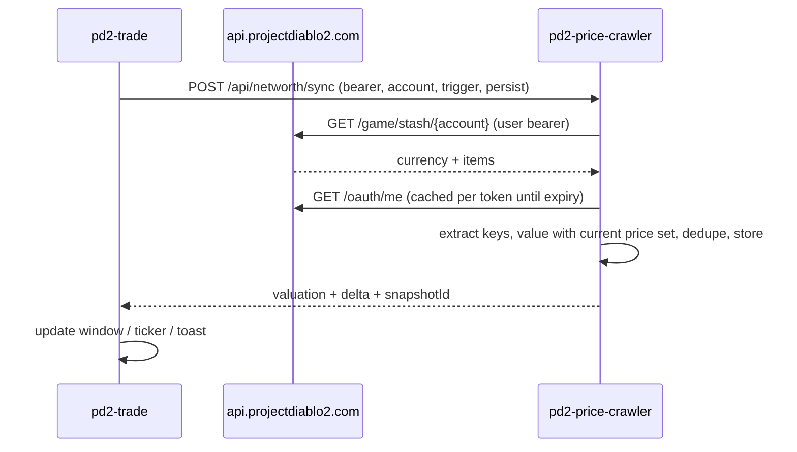

# PRD: Stash Value Redesign + Net Worth History ("Wealth Tracker")

|                    |                                                                                                                                                |
| ------------------ | ---------------------------------------------------------------------------------------------------------------------------------------------- |
| Status             | In build                                                                                                                                       |
| Repos              | `pd2-trade` (Tauri client, overlay) · `pd2-price-crawler` (NestJS + MongoDB, `pd2trader.com`; website SPA in `client/`)                        |
| Reference products | Wealthy Exile (stash tracker: currency/hour, tab breakdown, snapshots over time), Exilence CE (net worth overlay, income/hour, snapshot diffs) |
| Target             | Season 14 launch; M1 ships independently of history                                                                                            |

---

## 1. Summary

The stash value window becomes a net worth tracker. It shows the account's full net worth, records value over the season, works out income per session and per hour, and lists what was gained or lost between any two points. pd2-price-crawler values the stash and stores the history, so the client, overlay and history all use the same numbers. A compact overlay ticker shows current worth, change this session and HR/hour while playing.

## 2. Current state (evidence)

| Area                    | Today                                                                                                                                                       | Source                                        |
| ----------------------- | ----------------------------------------------------------------------------------------------------------------------------------------------------------- | --------------------------------------------- |
| Entry                   | `Ctrl+X` → `VIEW_IDS.CURRENCY` PanelView, 665×870, centered                                                                                                 | `MainWindow.tsx`, `useShortcuts.tsx`          |
| Categories              | Dropdown: runes (Lem–Zod only), 9 currency items, 13 uber mats                                                                                              | `CurrencyValuation.tsx`                       |
| Rune mapping            | `Object.keys(currency.runes).slice(19, 33).reverse()`; depends on key order                                                                                 | `CurrencyValuation.tsx:76`                    |
| Not valued              | Low runes (El–Fal), gems, craft mats, map mats (except catalyst), gold, jewel fragments; all uniques/sets                                                   | `GameStashResponse.ts` `Currency`             |
| Uniques/sets            | `UniqueSetItemsValuation.tsx` exists with per-tab breakdown but is **never mounted**; fetches prices one item at a time                                     | `pages/currency/components/`                  |
| Price fetch             | 3 sequential `POST /item-prices/average/batch`; price = `movingAverage7Days ?? medianPrice`; `hours: 168` + season `startDate`                              | `economyService.ts:8-19`, `useEconomyData.ts` |
| States                  | One spinner for loading, auth failure and API error; no refresh button; zero-quantity rows shown                                                            | `CurrencyValuation.tsx`                       |
| Types                   | `sampleCount` set at runtime, missing from `FormattedItem`                                                                                                  | `pages/currency/lib/types.ts`                 |
| Stash fetch             | `GET api.projectdiablo2.com/game/stash/{account}?softcore&ladder`, bearer token, in-memory 5 min cache                                                      | `useStashCache.ts`                            |
| History                 | None. Nothing persisted, client or server                                                                                                                   | —                                             |
| Seasons                 | Client-only list; `'current'` is a moving alias (S13 today)                                                                                                 | `src/lib/seasons.ts`                          |
| Server prices           | Daily crawl at 04:00 UTC; **ladder only** (SC+HC); trimmed mean, 7d MA, `sampleCount`                                                                       | `item-price.service.ts:206-214`               |
| Server prices: coverage | Runes, uber mats, cube/puzzlebox/puzzlepiece/catalyst/essences, facets, torch, anni, unique/set equipment. No gems, craft mats or map mats besides catalyst | `ingestion-config.ts`, `views/constants.ts`   |
| Server users            | No user/stash/season models; no websocket; no throttling; `POST /item-prices/crawl` and `/backfill` unauthenticated                                         | crawler scout report                          |
| Server auth             | OAuth PKCE proxy already requests `stash:read`; `/api/auth/oauth/me` proxies PD2 identity                                                                   | `auth.controller.ts`                          |
| Client libs             | `recharts ^3.5.1` (+ shadcn `chart.tsx`), `@tanstack/react-table`, `framer-motion`, `sonner`                                                                | `package.json`                                |

## 3. Goals / Non-goals

**Goals**

1. One net worth number that is easy to read, plus a breakdown by category and by tab that users trust: low-confidence prices are labelled, unpriced items are counted.
2. Net worth history for each account, ladder/mode and season, kept on the server and visible on any machine after login.
3. Session income and HR/hour, split into **farmed** (change in holdings) and **market drift** (change in prices).
4. Glanceable overlay: worth, change this session, HR/hour, snapshot freshness.
5. The same history on **pd2trader.com** after PD2 OAuth login, without the desktop app.
6. A single valuation engine (server) shared by the stash window, website, history and overlay.

**Non-goals (this PRD)**

- Pricing rares, magic items, runewords or crafted items (needs comparable-sales pricing; separate PRD).
- Character inventory and equipped gear (unless the stash API already returns them; see open questions).
- Combining several accounts or mules.
- Public leaderboards or social features (M4 candidate only).
- Prices updated within the day. Prices change once per day after each crawl.

## 4. Users and stories

- **Farmer**: "Was this 2-hour Uber Trist session worth it? HR/hour, and what dropped?"
- **Trader/flipper**: "Did my worth go up because I traded well or because Ber went up?" → farmed vs market split.
- **Season planner**: "Chart from season start to now; best day; peak."
- **Casual**: "How much is my stash worth?" Open with one hotkey and get one number without setup.

## 5. Feature set

Priority: **P0** required for the milestone · **P1** should ship in the milestone · **P2** later.

### A. Stash Value window (redesign of the `Ctrl+X` currency view)

| ID  | Feature                                                                                                                                                                                                          | Pri |
| --- | ---------------------------------------------------------------------------------------------------------------------------------------------------------------------------------------------------------------- | --- |
| A1  | **Header**: total net worth (HR), change vs last snapshot / 24h / season start, "as of" time, Refresh, Snapshot                                                                                                  | P0  |
| A2  | **Real tabs** instead of the dropdown: Overview · Runes · Currency · Uber Mats · Gems & Mats · Uniques & Sets · Other (unpriced rares/magic/runewords) · History                                                 | P0  |
| A3  | **Overview**: category share bar, top 10 holdings by value, "N items unpriced", "X HR uncertain" (low-confidence) line                                                                                           | P0  |
| A4  | **Complete coverage**: all 33 runes (low runes at fixed values), gems, craft mats, map mats, gold (excluded from HR total, shown separately), uniques/sets via server valuation                                  | P0  |
| A5  | **Tables**: icon, qty, unit price, value, % of total, 7d price change (`priceChange7Days`), confidence badge (`fixed` / `low` when `sampleCount < 10` / ok); sortable; hide-zero toggle (default on); search box | P0  |
| A6  | **States**: signed out → sign-in CTA; stash API error → message + retry; price API error → cached values marked stale; empty stash                                                                               | P0  |
| A7  | **Tab breakdown**: value per stash page/storage for item-based holdings; currency counts as a "Currency" bucket because `Currency` is a flat object with no per-tab data                                         | P1  |
| A8  | **Tab include/exclude** (e.g. leave a mule or junk tab out of the total); saved per account                                                                                                                      | P1  |
| A9  | Rune row popover reuses the existing rune breakdown (`getRuneBreakdown`)                                                                                                                                         | P1  |
| A10 | Corrupted uniques valued with corruption prices (`/item-prices/corruption-prices`)                                                                                                                               | P2  |
| A11 | Display unit selector (HR / Ist / Ber equivalents)                                                                                                                                                               | P2  |

### B. Snapshots and history (server-backed)

| ID  | Feature                                                                                                     | Pri |
| --- | ----------------------------------------------------------------------------------------------------------- | --- |
| B1  | **Snapshot**: holdings + valuation stored per PD2 user, account, ladder/mode, season                        | P0  |
| B2  | **History tab**: area chart of net worth; ranges 24h / 7d / Season / All seasons; season boundary markers   | P0  |
| B3  | **Stacked view** by category on the same chart (toggle)                                                     | P1  |
| B4  | **Snapshot list**: time, value, change, trigger (manual / interval / startup)                               | P0  |
| B5  | **Diff**: pick any two snapshots → items gained/lost with qty and value; price basis toggle "then" vs "now" | P0  |
| B6  | **Season summary card**: start value, peak, current, total farmed, total market drift, best session         | P1  |
| B7  | **Export CSV** of points and diffs                                                                          | P2  |
| B8  | **Delete my history** (all, or per season)                                                                  | P0  |
| B9  | Duplicate suppression: unchanged content updates `lastConfirmedAt` instead of inserting                     | P0  |

### C. Sessions and income

| ID  | Feature                                                                                                       | Pri |
| --- | ------------------------------------------------------------------------------------------------------------- | --- |
| C1  | **Auto sessions**: computed when read; a new session starts after a ≥30 min gap with no snapshots/D2 focus    | P0  |
| C2  | **Manual start/stop** markers that override the auto boundaries                                               | P1  |
| C3  | Per session: duration, start/end value, **farmed HR**, **market drift HR**, farmed HR/hour, top 5 gains       | P0  |
| C4  | Sessions list with sorting; best session highlighted                                                          | P1  |
| C5  | Session tags (e.g. "Uber Trist", "T5 maps") → average HR/hour per tag (similar to Wealthy Exile "Strategies") | P2  |

**Income math** (the definition of "farmed vs market"):

- Holdings `H(t)`, price set `P(d)` = daily prices for day `d`.
- `value(t) = H(t) · P(day(t))`
- Farmed between `t0`→`t1`: `(H(t1) − H(t0)) · P(day(t1))`
- Market drift: `H(t0) · (P(day(t1)) − P(day(t0)))`
- Farmed + market drift = `value(t1) − value(t0)` exactly. Prices change once per day, so market drift is 0 for most sessions.

### D. Overlay

| ID  | Feature                                                                                                                                                                                              | Pri |
| --- | ---------------------------------------------------------------------------------------------------------------------------------------------------------------------------------------------------- | --- |
| D1  | **Net Worth Ticker** (FixedView pill): `142.3 HR  ▲ +3.1 session  1.2 HR/h  ●` with a freshness dot (green < interval, amber stale, red error). Shown only while D2 is focused, like the chat button | P0  |
| D2  | Ticker anchor setting: top-left / top-center (default) / top-right / above chat button; opacity setting                                                                                              | P1  |
| D3  | **Mini panel** on ticker click (PanelView ~360×420): session sparkline, last 5 snapshot diffs, Snapshot now, Open full view                                                                          | P0  |
| D4  | **Snapshot toast** when \|change\| ≥ threshold (default 0.5 HR): `+1.2 HR · Ber, 2× Ist`; new `toastPopupTypes` entry `'networth'`                                                                   | P1  |
| D5  | **Hotkey**: take snapshot (unbound by default); **Command menu** entries: Take snapshot, Open Net Worth, Start/Stop session                                                                          | P0  |
| D6  | Auto-snapshot scheduler (see §8.4)                                                                                                                                                                   | P0  |

### E. Settings and privacy

| ID  | Feature                                                                                                                                                                          | Pri |
| --- | -------------------------------------------------------------------------------------------------------------------------------------------------------------------------------- | --- |
| E1  | One-time prompt on first open of History: "Track net worth over time? Snapshots are stored on pd2trader.com." Stored as `netWorthTrackingEnabled`                                | P0  |
| E2  | Settings section "Net Worth": tracking on/off, auto-snapshot interval (off / 5 / 10 / 15 (default) / 30 min), ticker on/off + anchor + opacity, toast threshold, snapshot hotkey | P0  |
| E3  | History is private and tied to the PD2 user id; no public endpoints expose it                                                                                                    | P0  |

### F. Website (pd2trader.com)

| ID  | Feature                                                                                                                                                                                                                      | Pri |
| --- | ---------------------------------------------------------------------------------------------------------------------------------------------------------------------------------------------------------------------------- | --- |
| W1  | **Sign in with PD2** on the website: same OAuth proxy; `start` takes `returnTo`, callback 302s back to `/wealth?oauth_state=…`, the page polls once and keeps tokens in localStorage (refresh via `/api/auth/oauth/refresh`) | P0  |
| W2  | **`/wealth` page**: account/ladder/hardcore/season selectors, header total + deltas, Refresh from PD2 (`POST /api/networth/sync`)                                                                                            | P0  |
| W3  | Overview: category share, holdings table (confidence, 7d %), tab breakdown                                                                                                                                                   | P0  |
| W4  | History: chart, snapshot list, diff, sessions — same data as the desktop History tab                                                                                                                                         | P0  |
| W5  | Delete my history; signed-out / empty / error states                                                                                                                                                                         | P0  |

## 6. UX sketches

**Stash Value window (Overview)**

```
┌ Net Worth ─────────────────────────────── Ladder SC · S14 ─┐
│  142.3 HR   ▲ +3.1 (last)  ▲ +18.4 (24h)  ▲ +96.0 (season) │
│  as of 14:32 · prices 2026-10-01      [↻ Refresh] [📸 Snap] │
├ Overview │ Runes │ Currency │ Uber Mats │ Gems&Mats │ Uniques&Sets │ History ┤
│ ████████████████▒▒▒▒▒▒▒▒░░░░  Runes 61% · Ubers 22% · U/S 14% · Other 3% │
│ Top holdings                         qty   unit    value  7d  │
│  Ber                                   9   3.00   27.00  ▲4% │
│  Black Soulstone                       6   1.40    8.40  ▼2% │
│  Shako (low conf.)                     1   0.80    0.80  —   │
│  …                                                           │
│ 37 items unpriced · 2.1 HR uncertain (low-confidence)        │
└──────────────────────────────────────────────────────────────┘
```

**History tab**

```
 [24h] [7d] [Season] [All]      [◻ Stack by category]
  ▁▂▂▃▃▄▅▅▆▆▇▇█   (area chart; season-start marker)
 Sessions                   dur    farmed   drift   HR/h
  Today 12:10–14:32       2h22   +3.10    0.00    1.31  ★
  Yesterday 20:05–23:40   3h35   +2.40   +0.6     0.67
 Snapshots                  value   Δ      trigger
  14:32                    142.3   +0.8   interval    [diff]
```

**Overlay ticker** (top-center of D2 frame)

```
 ╭───────────────────────────────────────────╮
 │ 142.3 HR  ▲ +3.1 session  1.3 HR/h   ●     │
 ╰───────────────────────────────────────────╯
```

## 7. Valuation rules (server, single source of truth)

1. **Holding keys** reuse the crawler's existing extraction: `ITEM_EXTRACTION_RULES` + `ITEM_GROUPING_RULES` run on stash items, so facets, torches and annis get the same `baseCode` as market prices. `[INFERENCE]` Stash items and market listing items share PD2's item shape; must be verified (open question 3).
2. **Price** for a key = `movingAverage7Days ?? medianPrice` from the existing average-price logic for that ladder/mode, window clamped to season start (the same basis the desktop used). Non-ladder is valued with ladder prices and flagged `priceSource: 'ladder-fallback'` because the crawler only crawls ladder.
3. **Low runes** El–Fal use fixed values (today `FIXED_RUNE_PRICES` / `ALL_RUNE_HR_VALUES` on the client). These move to the server and are returned in the price set.
4. **High runes** with `sampleCount < 10` fall back to the fixed table (the current `MIN_LISTINGS_FOR_API_PRICE` behaviour).
5. **Confidence**: other keys with `sampleCount < 10` count toward the separate "uncertain" sum, **not** the headline total (toggle to include).
6. **Unpriced**: rares, magic, crafted, runewords and anything with no price row are counted and listed but valued at 0.
7. **Gold**: shown separately and never converted to HR.
8. Each snapshot stores the unit price, confidence and sample count per holding, so it can be revalued at "then" (stored) or "now" (current) prices without a separate price history table.

## 8. Architecture

### 8.1 Key decision: who fetches the stash

| Option                                                                                                   | Pros                                                                                                                   | Cons                                                                                                          |
| -------------------------------------------------------------------------------------------------------- | ---------------------------------------------------------------------------------------------------------------------- | ------------------------------------------------------------------------------------------------------------- |
| **A. Client fetches the stash, uploads holdings; server checks the token and values them** (recommended) | PD2 stash calls come from users' own IPs, as today; no server-side PD2 rate-limit concentration; no stored user tokens | Client could fake holdings (only matters for leaderboards)                                                    |
| B. Server fetches the stash with the forwarded bearer token                                              | Tamper-resistant                                                                                                       | Every user's stash call leaves from one Heroku IP → rate-limit risk; server handles user tokens on every call |
| C. Server stores refresh tokens and snapshots on a schedule                                              | Works with the app closed                                                                                              | Holds long-lived credentials; little benefit because stashes only change while playing                        |

Decision: **B** for desktop and website. Clients never upload stash contents; the server fetches the stash itself through `POST /api/networth/sync`, so holdings can't be forged. (A was dropped: PD2 has no known rate limits, and trusted data is needed for anything public later.)

### 8.2 Flow



### 8.3 Server (pd2-price-crawler)

**New module** `NetWorthModule` (`src/networth/`): controller, service, guard.

**Auth guard** `Pd2UserGuard`: reads `Authorization: Bearer`, resolves `{userId, account}` through PD2 `/oauth/me` (reuse the `auth.controller.ts` proxy logic), and caches by SHA-256 of the token until its `exp`. The `account` in the body must equal the resolved account, otherwise 403.

**Collections**

```ts
// networth_points — small, kept indefinitely, drives charts
{
  userId: string; account: string; seasonId: string;
  isLadder: boolean; isHardcore: boolean;
  takenAt: Date; lastConfirmedAt: Date;           // B9 dedupe extends lastConfirmedAt
  trigger: 'manual' | 'interval' | 'startup';
  priceDay: string;                                // YYYY-MM-DD of price set used
  totalHr: number; uncertainHr: number; unpricedCount: number; gold: number;
  byCategory: Record<'runes'|'currency'|'ubers'|'gems'|'mats'|'uniques'|'sets', number>;
  byTab?: Record<string, number>;
  contentHash: string;
  snapshotId: ObjectId;                            // → stash_snapshots
}
// index: {userId, isLadder, isHardcore, seasonId, takenAt: -1}

// stash_snapshots — holdings, compacted (see retention)
{
  _id: ObjectId; userId: string;
  holdings: { key: string; category: string; qty: number; tab?: string; unitPrice: number | null; confidence: string; sampleCount: number }[]; // sparse, qty > 0 only
}

// seasons — constant list in server code (`src/seasons/`), served by GET /api/seasons; a deploy of the server (not the app) adds a season
{ id: 's14'; label: string; startDate: string; endDate: string | null }
```

**Retention**

- `networth_points`: kept indefinitely (≈300 B each).
- `stash_snapshots`: all kept for 14 days. After that, keep only session boundaries plus 1 per hour; after the season ends, session boundaries plus 1 per day. Points whose holdings are dropped can still be charted but not diffed.
- Rough sizing: holdings ≈ 2–6 KB sparse. `users × stored/day × 4 KB` (e.g. 1,000 × 10 ≈ 40 MB/day before compaction). Check the Atlas tier (open question 5).

**Endpoints**

| Method | Path                             | Notes                                                                                                                                                                                                                              |
| ------ | -------------------------------- | ---------------------------------------------------------------------------------------------------------------------------------------------------------------------------------------------------------------------------------- |
| POST   | `/api/networth/snapshots`        | Body `{account, isLadder, isHardcore, trigger, persist, stash: {currency, items[]}}`. `persist:false` returns a valuation only (used by the stash window when tracking is off). Returns `{valuation, delta, snapshotId?, deduped}` |
| POST   | `/api/networth/sync`             | Website: server fetches the stash with the user's bearer, then same as above (trigger `web`)                                                                                                                                       |
| GET    | `/api/networth/points`           | `isLadder, isHardcore, seasonId, from, to, resolution=raw\|hour\|day`                                                                                                                                                              |
| GET    | `/api/networth/snapshots/:id`    | Holdings + valuation                                                                                                                                                                                                               |
| GET    | `/api/networth/diff`             | `from, to, priceBasis=then\|now` → gained/lost lines                                                                                                                                                                               |
| GET    | `/api/networth/sessions`         | Computed when read (30 min gap rule + manual markers); farmed/drift/HR per hour                                                                                                                                                    |
| POST   | `/api/networth/sessions/markers` | `{type: 'start'\|'stop'}`                                                                                                                                                                                                          |
| DELETE | `/api/networth`                  | `?seasonId=` optional; deletes points + snapshots + markers                                                                                                                                                                        |
| GET    | `/api/networth/price-set`        | Current price set (fixed low runes included) so client features (Rune Exchange) stop keeping their own copy                                                                                                                        |
| GET    | `/api/seasons`                   | Season list                                                                                                                                                                                                                        |

**Jobs**: nightly compaction job; Nest `@Cron` (existing pattern).

**Server-side throttling**: at most 1 persisted snapshot per user per 2 min (excess returns the latest valuation with `deduped: true`), plus `@nestjs/throttler` on `/api/networth/*`.

### 8.4 Client (pd2-trade)

| Change                                                                            | Where                                                                                                                                                                                                                                                                                                          |
| --------------------------------------------------------------------------------- | -------------------------------------------------------------------------------------------------------------------------------------------------------------------------------------------------------------------------------------------------------------------------------------------------------------- |
| Redesigned window (tabs, header, states, tables) on server valuation              | `src/pages/currency/**` (`CurrencyValuation.tsx`, `Columns.tsx`, `DataTable.tsx`)                                                                                                                                                                                                                              |
| Delete `UniqueSetItemsValuation.tsx`; the server covers its job                   | `src/pages/currency/components/`                                                                                                                                                                                                                                                                               |
| `useNetWorth` hook: snapshot call, latest valuation, session state, scheduler     | `src/hooks/useNetWorth.ts` (new)                                                                                                                                                                                                                                                                               |
| Ticker + mini panel views                                                         | `VIEW_IDS.NET_WORTH_TICKER` (fixed), `VIEW_IDS.NET_WORTH_PANEL` (panel) in `useViewManager.ts`; render cases + default sizes in `MainLayout.tsx`; show/hide effect follows the chat-button pattern in `MainWindow.tsx`                                                                                         |
| Hotkey + command menu                                                             | `useShortcuts.tsx`, `CommandMenu.tsx`                                                                                                                                                                                                                                                                          |
| Settings                                                                          | `ISettings` + `DEFAULT_SETTINGS` in `useOptions.tsx`: `netWorthTrackingEnabled`, `netWorthTickerEnabled`, `netWorthTickerAnchor`, `netWorthTickerOpacity`, `netWorthAutoSnapshotMinutes`, `netWorthToastThresholdHr`, `hotkeyModifierSnapshot`/`hotkeyKeySnapshot`; form under `components/dialogs/optionsv2/` |
| Toast type `'networth'`                                                           | `toastPopupTypes` defaults (`useOptions.tsx:92`, `chat-form.tsx`)                                                                                                                                                                                                                                              |
| Seasons from server; history keyed by stable ids (`s14`), never `'current'`       | `src/lib/seasons.ts` becomes a fetch with bundled fallback                                                                                                                                                                                                                                                     |
| Rune Exchange / price check read fixed rune values from `/api/networth/price-set` | `economyService.ts`, `price-check/lib/constants.ts`                                                                                                                                                                                                                                                            |

**Auto-snapshot triggers** (only when tracking is enabled and the user is signed in):

1. App start (once the token is valid).
2. Every `netWorthAutoSnapshotMinutes` while D2 is focused (default 15). After 30 min with no holdings change (AFK), snapshots stop being stored and a value-only check runs once an hour; any change or a manual snapshot resumes the normal interval.
3. Manual: hotkey, command menu, button.
   No game-exit/log-based trigger: the stash API reflects loot within ~10 min, so interval snapshots are sufficient. The client skips a trigger if the previous snapshot is less than 2 min old and bypasses the 5 min stash cache for snapshot fetches. The interval floor stays at 5 min: PD2 has no known rate limits on `/game/stash`, but polling stays modest.

## 9. Milestones

| M                           | Scope                                                                                                                                                                                             | Exit criteria                                                                                                                                  |
| --------------------------- | ------------------------------------------------------------------------------------------------------------------------------------------------------------------------------------------------- | ---------------------------------------------------------------------------------------------------------------------------------------------- |
| **M0 Prereqs**              | Server: guard the open `crawl`/`backfill` endpoints (`ADMIN_API_KEY`); add throttler; `/api/seasons`. Client: parallel batch fetches; drop the `slice(19,33)` mapping; fix `FormattedItem` typing | Seasons endpoint live; admin endpoints reject unauthenticated calls                                                                            |
| **M1 Stash Value redesign** | A1–A6, A9; `POST /api/networth/sync` with `persist:false`                                                                                                                                         | Every `Currency` field plus uniques/sets valued or explicitly unpriced; totals match the server; error states reachable                        |
| **M2 History**              | B1, B2, B4, B5, B8, B9, C1, C3, E1–E3, A7                                                                                                                                                         | Snapshot → chart point visible on a second machine after login; diff between two snapshots lists exact gains/losses; delete removes everything |
| **M3 Overlay + sessions**   | D1, D3, D5, D6, D4, D2, C2, C4, B3, B6, A8                                                                                                                                                        | Ticker updates within 5 s of a snapshot; never captures clicks outside its rect; hidden when D2 is unfocused                                   |
| **M3b Website**             | W1–W5                                                                                                                                                                                             | Login on pd2trader.com → `/wealth` shows the same totals and history as the desktop for the same account                                       |
| **M4 Later**                | A10, A11, B7, C5; opt-in leaderboards (option B verification); multi-account                                                                                                                      | Separate review                                                                                                                                |

## 10. Success metrics

- ≥ 40% of weekly active signed-in users take ≥ 1 snapshot in week 1 of the season.
- ≥ 25% of those enable the ticker.
- Snapshot success rate ≥ 99% (Sentry + server logs); p95 `POST /api/networth/sync` < 2.5 s.
- No regression of the tsc/eslint baseline; no new Sentry issue classes from the ticker or scheduler.

## 11. Risks

| Risk                                                       | Mitigation                                                                                                                   |
| ---------------------------------------------------------- | ---------------------------------------------------------------------------------------------------------------------------- |
| Stash API lags loot by up to ~10 min                       | Show "as of" time on window and ticker; sessions/HR-per-hour unaffected at 15 min interval granularity                       |
| Non-ladder has no prices (crawler is ladder-only)          | M0 decision: add NL modes to `crawlAllItems` (the `crawlstates` schema already supports all 4) or show "ladder prices" on NL |
| Storage growth on Atlas                                    | Sparse holdings, dedupe, compaction; points kept small                                                                       |
| Two valuation engines drifting apart                       | Server owns valuation; client keeps no stash-valuation math; fixed rune table exposed through the price-set endpoint         |
| Server becomes user-data-bearing with open admin endpoints | M0 hardening is a hard prerequisite                                                                                          |
| Token forwarding concerns                                  | No token storage; cache only the token hash → identity until expiry                                                          |
| Day-1 season volatility makes 7d MA stale                  | MA window clamped to season start (existing `startDate` behaviour); show `lastDayPrice` in tooltips                          |

## 12. Open questions

1. Does the stash response include shared vs personal stash per character, and what are the `location.storage` values? Are inventory or equipped items included?
2. Non-ladder: crawl it (cost/time per crawl) or label it unsupported?
3. Do stash items and market listings share fields (`base_code`, `type_code`, modifiers) so the crawler's extraction/grouping rules apply as-is?
4. Does PD2 OAuth publish a JWKS so the guard can verify JWTs locally instead of calling `/oauth/me`?
5. Atlas tier and Heroku dyno limits for the new collections and jobs.

### Resolved

- **Stash freshness**: loot appears in `/game/stash` almost immediately, worst case ~10 min. Interval snapshots suffice.
- **Game log**: not used. No game-exit trigger; `pd2_game.log` stays out of scope.
- **Rate limits**: none known for PD2 API; keep 5 min interval floor and 2 min server dedupe anyway.
- **Terms**: storing stash snapshots is allowed. Opt-in prompt (E1) kept as a UX/privacy choice.
